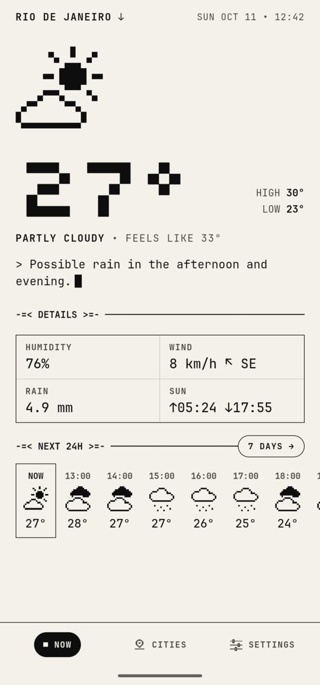
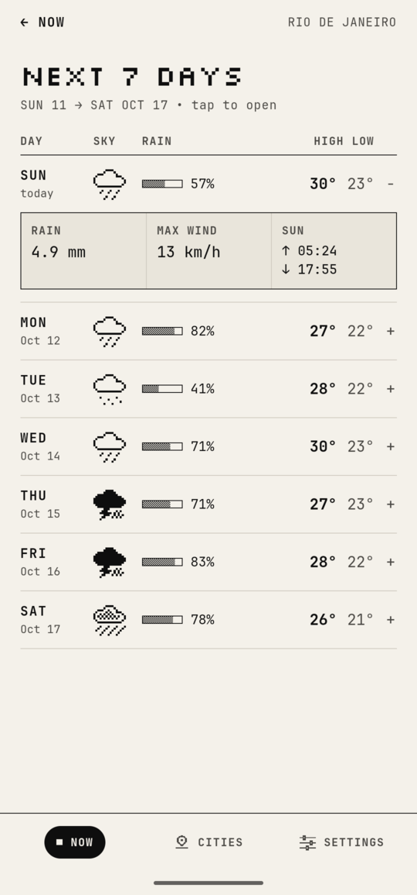
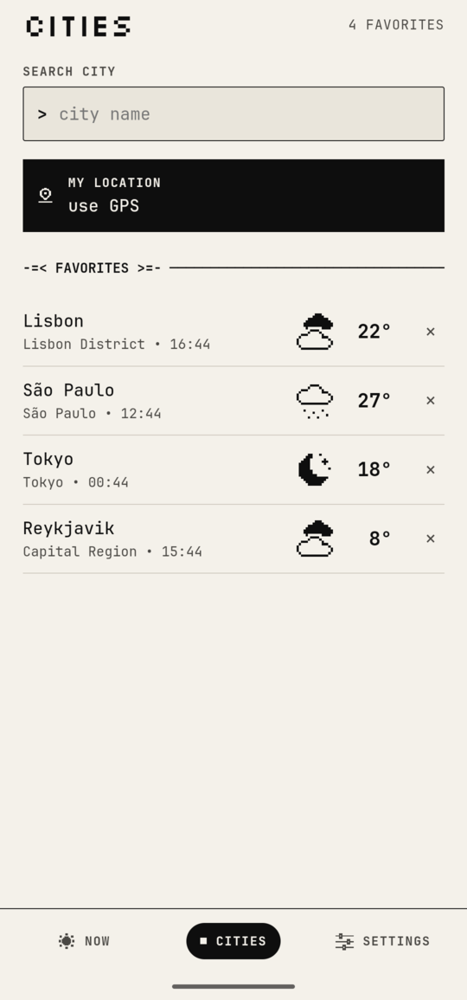
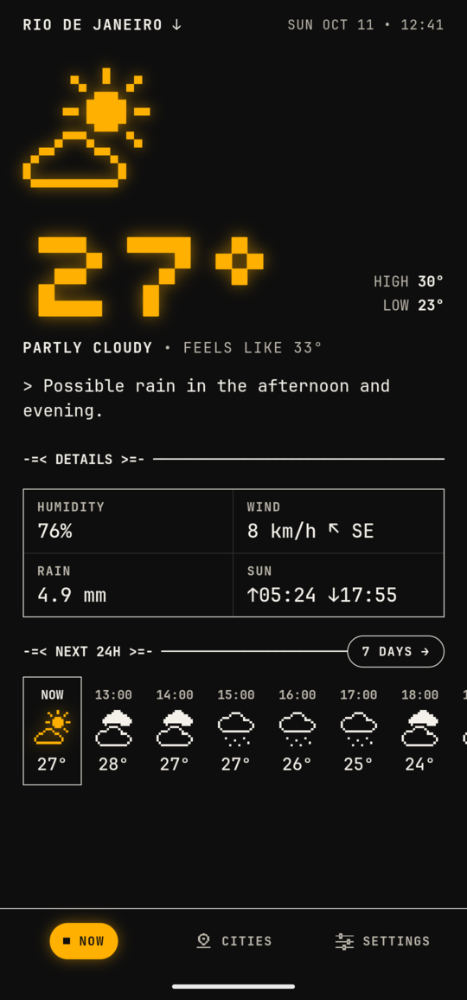
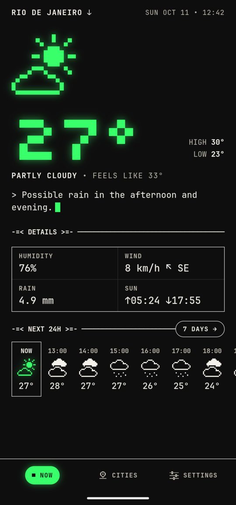
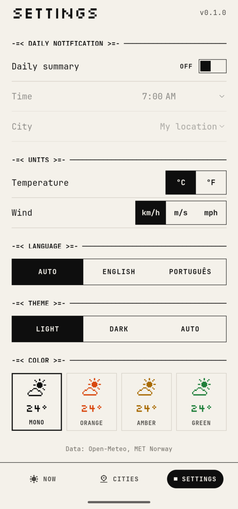

<div align="center">

```
      .--.
   .-(    ).    -=< JUST A WEATHER APP >=-
  (___.__)__)
    '  '  '     the weather, straight to the point
```

A weather app that looks like a terminal, with 1-bit Macintosh-style icons.<br>
Written as a web app (React + TypeScript) and packaged for Android with Capacitor.

</div>

<p align="center">
  
  
  
</p>
<p align="center">
  
  
  
</p>

## -=< Features >=-

- **Now:** temperature, feels-like, a one-line summary of the day ("Possible rain in the afternoon and evening.") and the next 24 hours
- **Next 7 days:** high, low and rain, with details on tap
- **Cities:** search by name, favorites showing each city's local time, and GPS location
- **Daily summary:** a notification at the time you choose with the day's forecast (Android)
- **Offline:** opens instantly with the last saved forecast, then refreshes
- **Look:** light, dark or system theme; monochrome or with an orange, amber or phosphor-green accent
- **Languages:** English and Portuguese, following the device language (or picked in Settings)

## -=< How it works >=-

The forecast doesn't come from a single source. The app queries five weather models and combines the results:

```
  Open-Meteo ──┬── ECMWF  (Europe) ──┐
               ├── GFS    (USA) ─────┤
               ├── ICON   (Germany) ─┼──▶ consensus ──▶ screen and notification
               └── ARPEGE (France) ──┤
  MET Norway ────────────────────────┘
```

- **Numbers** (temperature, rain, wind): the median across sources, so one outlier model doesn't skew the result.
- **Sky condition:** majority vote; on a tie, the most severe wins (better to carry an umbrella for nothing).
- **Agreement:** when the models disagree, the wording gets more cautious: "Rain in the afternoon" becomes "Possible rain in the afternoon".
- If a source fails, the others carry on. Sources and confidence stay behind the scenes; the screen shows only the result.

All APIs are free and need no key.

## -=< Running >=-

Requirements: Node.js LTS and, for Android, [Android Studio](https://developer.android.com/studio).

```bash
npm install
npm run dev        # in the browser
npm run android    # build + sync + open in Android Studio (Run ▶)
```

If Capacitor can't find Android Studio, set `CAPACITOR_ANDROID_STUDIO_PATH` (e.g. `/opt/android-studio/bin/studio.sh`).

### APK to install on your phone

```bash
npm run apk
# → android/app/build/outputs/apk/release/app-release.apk  (~1.5 MB)
```

The release build is minified and signed. The version comes from `package.json` (`0.1.0` → versionCode `100`); run `npm version patch` before building an update.

Signing uses an `android/keystore.properties` file, which is kept out of git:

```properties
storeFile=/path/to/your-key.jks
storePassword=...
keyAlias=release
keyPassword=...
```

> [!IMPORTANT]
> Back up the key and its password. Without the same key, Android won't install an update over the existing app.

To install, send the APK to your phone and open it. Android will ask you to allow "install unknown apps".

## -=< Scripts >=-

| Command | What it does |
| --- | --- |
| `npm run dev` | Development server |
| `npm run build` | Production build in `dist/` |
| `npm test` | Tests (Vitest) |
| `npm run lint` | Lint (oxlint) |
| `npm run sync` | Build + `cap sync` |
| `npm run android` | Build + sync + open Android Studio |
| `npm run apk` | Build + sync + signed release APK |

## -=< Structure >=-

```
src/
├── api/            Open-Meteo, MET Norway and city search
├── consensus/      combines the sources: median, agreement, condition vote
├── components/     16×16 pixel icons, navigation, ASCII loader
├── hooks/          forecast, location, favorites summary
├── i18n/           texts in English and Portuguese
├── lib/            formatting, daily summary text, time zones
├── notifications/  planning and scheduling the daily summary
├── screens/        Now, Next days, Cities, Settings
├── state/          settings, favorites and selected city
├── storage/        cache of the last forecast
├── styles/         color tokens and styles
└── types/          data contract
android/            native project (Capacitor)
assets/             icon and splash sources
```

## -=< Notes >=-

- **Languages:** English is the default; Portuguese is used when the device is set to Portuguese. Texts live in `src/i18n/` (one file per language), so adding another means translating `en.ts` and registering it in `src/i18n/index.ts`.
- **Daily notification:** every time the app opens, it reschedules the next 7 days with the latest forecast. If it isn't opened for days, notifications keep coming with the last forecast available. Some manufacturers delay or block scheduled notifications to save battery; see [dontkillmyapp.com](https://dontkillmyapp.com).
- **Permissions:** approximate location only (enough for weather) and notifications.
- **iOS:** Capacitor supports it, but building requires a Mac with Xcode. Not done yet.

## -=< Stack >=-

[React 19](https://react.dev/) · [TypeScript](https://www.typescriptlang.org/) · [Vite](https://vite.dev/) · [Capacitor 8](https://capacitorjs.com/) · [Vitest](https://vitest.dev/) · [oxlint](https://oxc.rs/)

## -=< Credits >=-

- Data: [Open-Meteo](https://open-meteo.com/) and [MET Norway](https://api.met.no/), both under CC BY 4.0
- Fonts: [JetBrains Mono Nerd Font](https://www.nerdfonts.com/) and [Silkscreen](https://fonts.google.com/specimen/Silkscreen), under the OFL
